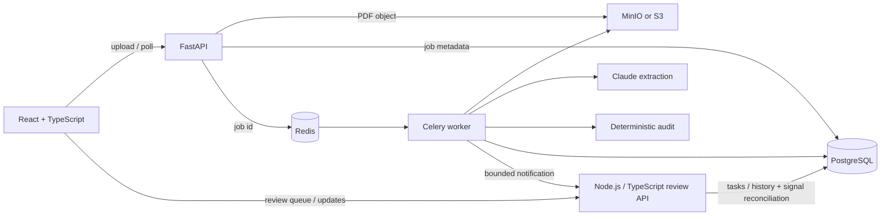

# FreightIQ

FreightIQ turns freight-invoice PDFs into validated, reviewable records without holding
an HTTP request open while the document is processed.

## Demo

There is no hosted demo. The complete stack runs locally with Docker Compose.

## Problem

Freight invoices mix semi-structured text with calculations that must be exact. FreightIQ
uses Claude only to extract a typed candidate record; ordinary Python code then checks
required fields, dates, line-item arithmetic, duplicate charges, subtotals and totals.

## Architecture



The upload endpoint validates the PDF, stores it under an opaque object key, creates a
durable job and returns `202 Accepted`. A Celery worker performs extraction and auditing.
Retries lock the job row and reuse its document, so they cannot create duplicate invoices.

FastAPI/Celery owns document ingestion, extraction, validation and deterministic
audit findings. The standalone Fastify service owns review tasks, status transitions,
resolution notes and transactional audit history. It reads document metadata and
existing findings from PostgreSQL; it does not change extracted invoice values.
One Alembic migration chain coordinates the shared schema. See the
[repository audit and implementation decisions](docs/review-workflow.md).

## Key engineering features

- Four explicit job states (`queued`, `processing`, `completed`, `failed`) with safe error codes
- S3-compatible document storage with content metadata and SHA-256 integrity metadata
- Strict Pydantic validation around Claude JSON; bounded input and request timeout
- Deterministic decimal arithmetic and duplicate-charge detection outside the model
- SQLAlchemy 2 models and versioned Alembic migrations on PostgreSQL
- Typed React polling flow with upload, processing, failure and completed states
- Prometheus metrics for bounded-route API traffic and durable worker outcomes
- Tests for the API, worker idempotency, parser, validation, malformed model output,
  audit arithmetic and a real MinIO object round trip

## Tech stack

React 19, TypeScript, Vite, FastAPI, Pydantic, SQLAlchemy, Alembic, PostgreSQL,
Redis, Celery, Anthropic Claude, MinIO/S3, Prometheus metrics, Docker Compose, pytest
and GitHub Actions.
The review service adds Node.js 22+, strict TypeScript, Fastify 5, Zod 4,
node-postgres and Vitest. React component tests use Testing Library and jsdom.

## Repository structure

```text
backend/        FastAPI, worker, domain logic, migrations and pytest suite
frontend/       React/TypeScript application
review-service/ Fastify routes, services, PostgreSQL access and Vitest API tests
docs/           implementation checklist and engineering notes
docker-compose.yml
```

## Local setup

1. Copy `.env.example` to `.env`. Set `ANTHROPIC_API_KEY` for live extraction;
   the unreadable-PDF review demo below works without a key.
2. Start the backend stack:

```sh
docker compose up -d --build --wait
```

The first build compiles MinIO from the immutable upstream commit for
`RELEASE.2025-09-07T16-13-09Z` and can take several minutes. MinIO's community
distribution is [source-only](https://github.com/minio/minio); the previously used
registry image is unavailable. The storage API and existing data volume are unchanged.

3. Start the frontend in a second terminal:

```sh
cd frontend
npm ci
npm run dev
```

FastAPI is at `http://localhost:8000`, OpenAPI at `http://localhost:8000/docs`, the UI
at `http://localhost:5173`, the Node review API at `http://localhost:8001`, and the
MinIO console at `http://localhost:9101`. Vite proxies `/api/review-tasks` to Node
and the remaining `/api` requests to FastAPI. The migration container completes
before API, worker and review startup. Use `docker compose logs review worker`
to inspect service outcomes.

If port 8000 is occupied, set `API_PORT=8010` in the root `.env` and
`FASTAPI_PROXY_TARGET=http://127.0.0.1:8010` in `frontend/.env`. The equivalents for
Node are `REVIEW_PORT` and `REVIEW_PROXY_TARGET`. See `frontend/.env.example`.

For backend development outside Docker, create a Python 3.11 environment, install
`backend/requirements-dev.txt`, copy `backend/.env.example` to `backend/.env`, and run
`alembic upgrade head` before starting Uvicorn.

For Node development outside Docker, stop the Compose `review` container, copy
`review-service/.env.example` to `review-service/.env`, then run:

```sh
cd review-service
npm ci
npm run dev
```

`npm run build` compiles production JavaScript and `npm start` runs it. The server
defaults to loopback, uses a bounded PostgreSQL pool and query timeouts, emits
structured JSON logs without document/notes/request bodies, and drains HTTP,
reconciliation and database connections on SIGINT/SIGTERM. Production browser
hosting must route the two API prefixes through a reverse proxy; Vite's dev proxy
does not ship in the static frontend build.

## Environment variables

`.env.example` documents PostgreSQL, CORS, Anthropic and S3 credentials. The checked-in
values are local-development defaults only. Do not commit a populated `.env` file.

| Variable | Consumer / default | Purpose |
|---|---|---|
| `API_PORT` | Compose / `8000` | FastAPI loopback host port |
| `REVIEW_PORT` | Compose / `8001` | Node loopback host port |
| `REVIEW_DATABASE_URL` | Node / required | `postgresql://` connection URL (not SQLAlchemy's `+psycopg` URL) |
| `HOST`, `PORT` | Node / `127.0.0.1`, `8001` | Listen address; Compose uses `0.0.0.0` inside its private network |
| `LOG_LEVEL` | Node / `info` | Structured logger severity |
| `RECONCILE_INTERVAL_MS` | Node / `30000` | Recovery sweep interval, minimum 1000 ms, 100 candidates per sweep |
| `REVIEW_SERVICE_URL` | Python / `http://localhost:8001` | Notification destination; Compose uses `http://review:8001`; empty disables notifications |
| `REVIEW_SERVICE_TIMEOUT_SECONDS` | Python / `2` | Notification timeout; failures do not fail processing |
| `FASTAPI_PROXY_TARGET` | Vite / `http://127.0.0.1:8000` | FastAPI proxy destination |
| `REVIEW_PROXY_TARGET` | Vite / `http://127.0.0.1:8001` | Review proxy destination |
| `TEST_DATABASE_URL` | Node tests / local `freightiq_review_test` | Disposable migrated PostgreSQL database, name must end in `_test` |

## Review API

All identifiers are positive integer database IDs. JSON bodies reject unknown keys.
Statuses on the wire are `pending`, `in_review`, `resolved`; the UI labels them
Pending, In Review and Resolved.

| Method / path | Behavior |
|---|---|
| `GET /api/review-tasks?status=pending&page=1&page_size=20` | `{items,total,page,page_size}`, newest first, optional status, page size 1–100 |
| `GET /api/review-tasks/:id` | Task plus document filename, invoice ID/number/carrier and processing error code |
| `POST /api/review-tasks` | `{document_id, reason?}`; validates the existing document; derives reason from persisted findings, or requires a manual reason |
| `PATCH /api/review-tasks/:id` | `{version, status?, notes?, resolution?}`; at least one edit field required |
| `GET /api/review-tasks/:id/history` | Ordered creation, status-change and note-edit snapshots |
| `GET /health` | Process liveness, independent of PostgreSQL |
| `GET /ready` | Database and review-table availability; 503 when unavailable |

Creation returns 201, or 200 with `replayed: true` for an existing task. A unique
document constraint prevents concurrent duplicates, including after resolution.
Transitions are strictly Pending → In Review → Resolved; resolving requires
nonblank `resolution`. Notes and resolution text are limited to 10,000 characters.
Each real edit increments `version`, updates timestamps and records history in
the same transaction. Pass the version from the last read; stale edits return 409.
Reload the task and reconcile your notes before retrying.

Errors have `{error: {code, message}, request_id}`. Validation returns 400,
missing resources 404, invalid transitions/stale edits 409, missing resolution or
review reason 422, and unavailable dependencies 503. Database diagnostics and
document contents are not returned to clients.

The Python worker sends a bounded HTTP notification after committing a completed
invoice or a permanent failure. Node creates tasks for persisted audit findings
(errors **and** warnings), schema-invalid extraction, and unreadable/unparseable
PDFs. Configuration and network failures do not qualify as document exceptions.
If a notification fails, Node's startup/periodic sweep recovers the same signals
from PostgreSQL. Large backlogs take multiple sweeps. Recovery never resets an
existing task. History origin is `operator` or `pipeline`, not an authenticated
identity. Resolution records the decision without changing source evidence.

## Migrations

Review tables are introduced by `0003_review_workflow`, following the two existing
migrations. Node owns their writes; SQLAlchemy includes schema-only models so
`alembic check` covers the entire shared schema. Do not run a separate Node schema
initializer or use ORM `create_all` at startup.

```sh
docker compose run --rm migrate
docker compose run --rm api alembic check
```

Outside Docker, run `alembic upgrade head` from `backend/` with `DATABASE_URL`
configured before starting either service. Migration failure prevents Compose
dependents from starting.

## Testing

The backend suite uses real PostgreSQL and MinIO but mocks external model calls, so it
does not consume Claude credits:

```sh
docker compose up -d postgres redis minio --wait
docker compose run --rm api alembic upgrade head
docker compose run --rm api alembic check
docker compose --profile test build tests review review-tests review-test-migrate
docker compose --profile test run --rm tests python -m ruff format --check .
docker compose --profile test run --rm tests python -m ruff check .
docker compose --profile test run --rm tests
docker compose --profile test run --rm review-tests
cd review-service
npm ci
npm run typecheck
npm run lint
npm run build
cd ../frontend
npm ci
npm run lint
npm test
npm run typecheck
npm run build
```

Python tests truncate the configured application database, as the original suite
did: use a disposable local Compose stack and stop the worker while testing. Node
tests run against a separate disposable `freightiq_review_test` database prepared
by `review-test-migrate` using the same Alembic chain. Never point tests at valuable
data. Node tests cover real SQL persistence, duplicate/concurrent writes,
transitions, pagination, missed notifications, rollback and dependency failures.
The Python integration suite calls the running Node service over HTTP and checks
the saved PostgreSQL resolution; that test is skipped outside Compose unless
`REVIEW_INTEGRATION_URL` is configured. External model calls are mocked in tests.

To run Node tests from the host after preparing the test database:

```sh
docker compose --profile test run --rm review-test-migrate
cd review-service
npm test
```

The frontend component tests exercise queue rendering/filtering, HTTP failures,
resolution requirements, status updates and reload persistence against a stateful
HTTP test double. Real service/database behavior is covered by the backend tests
and the local demo below.

## Practical review demo

Start the full stack and frontend as above. For a deterministic demonstration
without an Anthropic key, upload an actual one-page PDF containing no readable text:

```sh
docker compose exec api python demo_review.py
```

This uses the existing upload API, MinIO, Redis and Celery. The job fails with
`pdf_has_no_text`; Node creates a Pending review task. In React, open **Review
Queue**, refresh, open `demo-unreadable-invoice.pdf`, enter follow-up notes and
select **Start review**. Add a resolution such as "Requested a readable invoice
from the carrier", then select **Resolve task**. Reload the task or filter the
queue by Resolved to confirm persistence. The UI explicitly shows that no
extracted invoice exists for an unreadable PDF.

To demonstrate successful extraction with real audit exceptions, configure a
valid Anthropic key and upload the existing sample (intentional duplicate fuel
charge and incorrect line total):

```sh
docker compose exec api python demo_review.py --file sample_invoice.pdf
```

Alternatively upload `backend/sample_invoice.pdf` using React. The worker retains
the existing model extraction and deterministic audit; generated flags create a
review task with invoice details and audit results. Model execution requires a
configured key and is not claimed as part of the no-key demo.

Inspect persisted decisions directly:

```sh
docker compose exec postgres psql -U freightiq -d freightiq -c "SELECT id, document_id, status, version, resolution, resolved_at FROM review_tasks ORDER BY id;"
docker compose exec postgres psql -U freightiq -d freightiq -c "SELECT task_id, from_status, to_status, version, origin, created_at FROM review_history ORDER BY id;"
```

To exercise recovery, stop Node, upload the unreadable document, wait for the
worker to finish, then restart Node. The persisted failure is picked up by the
startup sweep even though the HTTP notification failed:

```sh
docker compose stop review
docker compose exec api python demo_review.py
docker compose start review
```

## Frontend-only checks

```sh
cd frontend
npm ci
npm run typecheck
npm run lint
npm test
npm run build
```

## Architecture decisions

- **PostgreSQL** is the durable source of truth and provides constraints and row locking.
- **Redis and Celery** keep variable-duration model work out of the request lifecycle.
- **S3-compatible storage** keeps binary documents out of relational rows and supports
  local MinIO plus an AWS S3 endpoint without changing application code.
- **Pydantic plus deterministic auditing** treats model output as untrusted input and
  reserves exact calculations for code.
- **Polling** is intentionally simpler than WebSockets for this one-job-at-a-time workflow.

## Current status

Implemented: asynchronous PDF ingestion, durable jobs, object storage, Claude extraction,
deterministic audits, PostgreSQL migrations, React polling, Prometheus-format API/worker
outcome metrics, Docker development and CI tests.
Document review adds a PostgreSQL-backed Node API, eventual recovery from missed
notifications, version-checked operator updates, audit history and a React queue.
See [local verification evidence and limitations](docs/review-verification.md).

This repository does not claim production users, accuracy figures or a live deployment.

## Future work

Authentication and tenant isolation are the first prerequisites for any hosted version,
followed by encrypted production storage, retention/deletion controls and deployment.

## Security boundary

Uploads require a PDF MIME type and signature and are size-limited. Original filenames
are sanitized and never become object keys. CORS origins are explicit. Logs and persisted
errors exclude document contents and secrets. The local services use development
credentials and bind published ports to loopback; the app has no authentication and must
not be exposed directly to the public Internet.
