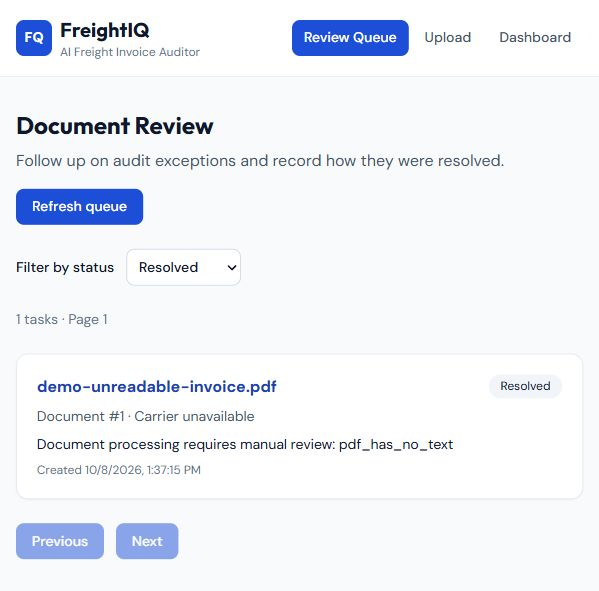

# Review workflow verification — 2026-10-08

Verified locally on branch `codex/document-review-workflow`, based on fetched
`origin/main` commit `fbc84e00ad2c0360b0c553c38ec0e99843aa33cf`.
This is local evidence, not a production deployment or a GitHub Actions run.

| Check | Observed result |
|---|---|
| Node TypeScript check, ESLint, production compilation | All exit 0 |
| Node Vitest suite, host and Docker Node 22 | 19 passed; real PostgreSQL in isolated `freightiq_review_test` |
| Frontend TypeScript check and ESLint | Both exit 0 |
| Frontend Vitest / Testing Library | 4 passed |
| Frontend production build | Vite 6.4.3 build succeeded |
| Existing and new Python tests | 27 passed, none skipped in Compose |
| Python formatting and lint | Ruff format/check passed |
| Migrations | Upgraded existing application schema and fresh test database to `0003_review_workflow` |
| Alembic schema check | `No new upgrade operations detected.` |
| Docker Compose | `docker compose config --quiet` exits 0; API/review/PostgreSQL/Redis/MinIO healthy; worker running |
| New Node dependency audit | `npm audit` and production-only audit report zero vulnerabilities |

The Node suite tests validation, missing documents, real task/history persistence,
concurrent create deduplication, valid/invalid transitions, stale version conflicts,
filtering/pagination, recovery of missed signals, terminal-task preservation,
transaction rollback when history fails, and safe unavailable-database responses.
The Python integration test invokes the actual Node HTTP API after a flagged
document is processed and verifies the final status/resolution/history in SQL.
External model calls are mocked in automated tests.

### Publish follow-up — 2026-10-11

The initial GitHub backend job could not pull the old MinIO registry image.
Built MinIO from release commit `07c3a429bfed433e49018cb0f78a52145d4bedeb`,
restarted it against the existing data volume, and observed a healthy container.
Reran the complete Python suite against this image: **27 passed**, including
the S3 object/metadata round trip and live Python-to-Node review integration.

## Real local demo and browser evidence

1. Started the actual Celery worker; deliberately stopped Node.
2. Ran `docker compose exec api python demo_review.py`.
3. The API stored a generated one-page blank PDF in MinIO and queued a real job.
   The worker recorded `failed` / `pdf_has_no_text`; its unavailable Node
   notification did not break the processing result.
4. Restarted Node. Its startup sweep recovered one Pending task from PostgreSQL.
5. In React, opened the task, entered review notes, and selected Start review.
   Verified Resolve task was disabled while resolution notes were empty.
6. Entered an explicitly labeled demo decision and resolved the task. Reloaded
   from the server and filtered the queue by Resolved.
7. Queried PostgreSQL: document 1/task 1 was `resolved`, version 3, with a non-null
   `resolved_at` and the saved demo resolution. History contained creation,
   Pending → In Review and In Review → Resolved, in versions 1/2/3.

The running local UI uses port **5174** and FastAPI uses **8010**, because 5173
and 8000 were occupied by other applications. Ignored local `.env` files configure
the FastAPI port and Vite proxy; checked-in examples retain standard defaults.
The review API uses 8001. The demo record remains available for inspection.

## Limits

- No live paid model extraction was performed; the unreadable-PDF demo requires no
  model, and automated extraction/audit integration uses explicitly mocked model
  output. A configured Anthropic key is still needed for the supplied sample PDF's
  successful extraction path.
- No authentication/tenant isolation exists in the original app or this feature.
  Host ports remain loopback-only. History origin is not an authenticated identity.
- The queue recovers up to 100 missed tasks per sweep (default interval 30 seconds).
  Resolved tasks cannot be reopened, and notes do not alter source invoice values.
- Frontend component tests use a stateful HTTP test double; the browser demo
  exercises the real APIs, worker, object store and database.
- Seven npm advisories remain in the existing Tailwind 3 development toolchain
  (five high, two moderate). Its suggested major Tailwind upgrade was not mixed
  into this feature. The newly added Node service audit is clean.
- GitHub CI's frontend job passed on the published feature branch. Backend CI
  initially stopped before testing because the existing MinIO image was unavailable.
  Compose now builds the same MinIO release from its immutable upstream source
  commit; the pull request's checks are the authoritative remote test status.
  No hosted deployment is claimed.

## Accurate resume bullet

Built a Node.js/TypeScript exception-review service with Fastify, Zod and PostgreSQL,
integrating a React operator queue with a Python/Celery document pipeline through
idempotent notifications, recovery sweeps, version-checked updates and transactional
audit history; verified with 50 automated tests and a local Docker workflow.
